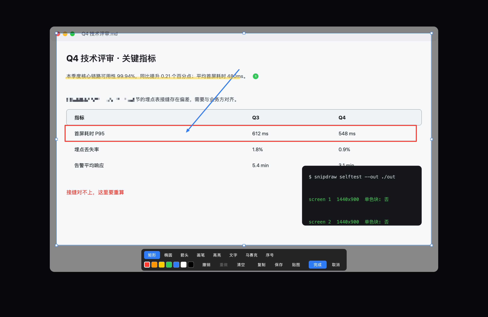
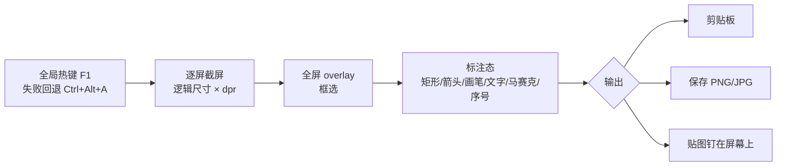
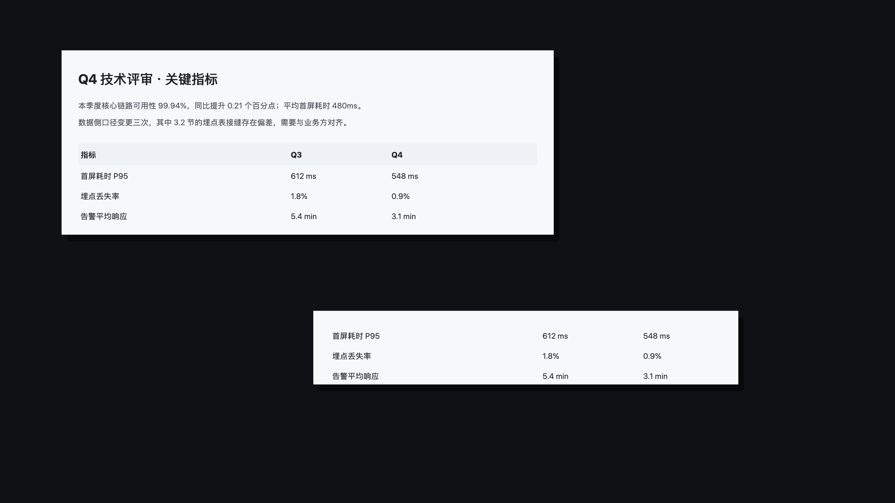
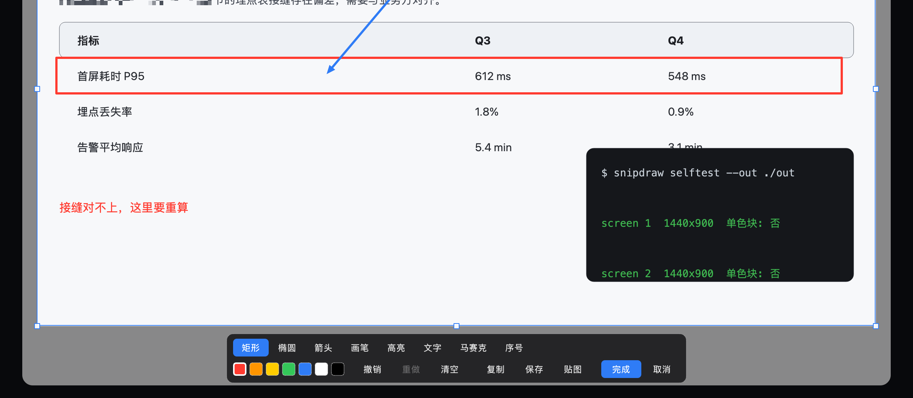
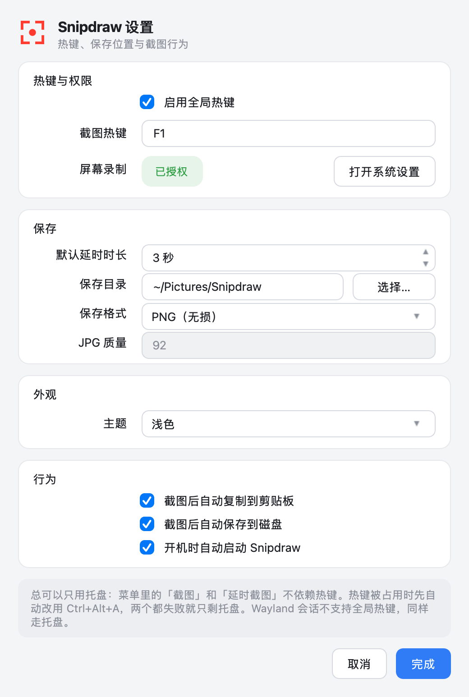

# Snipdraw
跨平台截图标注工具，交互范式借鉴 Snipaste。基于 Python 3.10+（3.10–3.13）与 PySide6（Qt 6），
后期可按 `core/` 的边界平移到 C++ Qt。支持 Windows、macOS 与 Linux X11。

<p>
    <a href="https://github.com/LL-Store/Snipdraw/issues">
        
    </a>
    <a href="https://github.com/LL-Store/Snipdraw" target="_blank">
        
    </a>
    <a href="https://github.com/LL-Store/Snipdraw">
        
    </a>
    
    
    <a href="LICENSE">
        
    </a>
</p>

<p align="center">
    
</p>

<p align="center">
    <sub>框选即进标注态：矩形 / 箭头 / 高亮 / 序号 / 文字都画在物理像素坐标上，工具栏随选区浮动，不会被截进图里。</sub>
</p>

## 它怎么工作

| 能力 | 说明 |
| --- | --- |
| 一个热键走完全程 | 截屏 → 框选 → 标注 → 复制 / 保存 / 贴图，不弹多余窗口 |
| 一次框选，三种去处 | 回车进剪贴板、`Ctrl+S` 落盘、工具栏「贴图」原地钉住 |
| 坐标按物理像素存 | 线宽、字号按 `物理/逻辑` 比例放大，Retina 与 4K 下与导出 PNG 一致 |
| 不依赖 Qt SDK | `pip install -e .` 即跑，不需要 Qt Creator / CMake；`core/` 可平移到 C++ Qt |
| 有回归网兜底 | 75 条自动化测试 + `selftest`（查黑图、查 `逻辑尺寸 × dpr`）+ 打包体积守护 |



整条链路上没有常驻的后台线程：热键由原生 `RegisterHotKey` / `XGrabKey` 注册，
按下后走 Qt 事件循环同步取景，出图、贴图、写盘都在主线程完成后回到托盘。

## 贴图

标注工具栏上的「贴图」会把当前结果钉在屏幕上，位置和尺寸按原选区还原——
贴出来的图跟被你框住的那块区域长得一模一样，不会跑到屏幕中间。

<p align="center">
    
</p>

| 操作 | 效果 |
| --- | --- |
| 左键拖动 | 移动贴图；松手不掉层级 |
| 滚轮 | 缩放 0.2×–4×，**以光标为锚点**，不会跳 |
| Ctrl / ⌘ + 滚轮 | 调透明度，10% 一档 |
| 右键 | 复制 / 保存 / 1:1 / 放大 / 缩小 / 透明度 / 关闭 / 关闭全部 |
| 双击、`Esc` | 关闭 |
| `Ctrl+C` / `Ctrl+S` | 复制 / 保存 |

贴图窗口是独立的浮动窗（`Frameless + StaysOnTop + Tool`），macOS 上停在
`NSFloatingWindowLevel`——高于普通窗口，但不会像全屏 overlay 那样去压菜单栏。
数量上限取设置里的 `pin_limit`（默认 20），超了自动关最旧的。
按既定决策，贴图**不跨重启恢复**。

## 标注

框选后自动进入标注态，选区下方浮出工具栏（它是 overlay 的子控件，随选区移动、不会被截进图里）。

<p align="center">
    
</p>

| 工具 | 快捷键 | 说明 |
| --- | --- | --- |
| 矩形 / 椭圆 | `R` / `E` | 空心描边，默认线宽 3 像素 |
| 箭头 | `A` | 箭杆自动缩进，三角箭头 |
| 画笔 / 高亮 | `P` / `H` | 高亮是半透明加粗的画笔 |
| 文字 | `T` | 原生 `QLineEdit` 输入，支持中文输入法 |
| 马赛克 | `M` | 不烘像素，每次从原图重新取样，所以能移动、能撤销 |
| 序号 | `N` | 圆标 ①②③，自动递增 |

`Enter` 完成、`Esc`/右键取消、`Ctrl+Z` 撤销、`Ctrl+Shift+Z` 重做、`Ctrl+C` 复制、
`Ctrl+S` 保存、`Backspace` 撤回上一个图元。

图元坐标全部用**物理像素**存储，绘制时按 `物理/逻辑` 比例放大线宽与字号，
因此 Retina 屏上看到的粗细与导出的 PNG 完全一致。

## 开发环境

只需要 Python，不需要 Qt SDK、Qt Creator 或 CMake：

```bash
python3.11 -m venv .venv          # 3.10–3.13 都行；PySide6 的 wheel 对 3.14 支持滞后，别用最新版
source .venv/bin/activate         # Windows: .venv\Scripts\Activate.ps1
pip install -e ".[dev]"
```

Windows 上有个坑：`python` 可能落到应用商店版 3.9（`WindowsApps\python.exe`），
它既没 PyInstaller 也没 PySide6，版本还低于 3.10，拿它打包只会得到一句
`CalledProcessError ... returned non-zero exit status 1`。先建对解释器的环境：

```powershell
py -3.10 -m venv .venv
.\.venv\Scripts\python.exe -m pip install -e ".[dev]"
```

## 运行

```bash
python -m snipdraw                # 进入托盘常驻，按热键截图
```

默认热键 `F1`，可在托盘「设置…」里改。macOS 上 F1 默认是亮度键，
需要在「系统设置 → 键盘 → 将 F1、F2 用作标准功能键」里勾选，否则按 Fn+F1。
热键注册失败会自动回退到 `Ctrl+Alt+A`，并在托盘提示；两个都抢不到就只剩托盘。
设置页里取消勾选「启用全局热键」可以彻底不注册热键，避免和别的软件抢（此时托盘菜单
里的「截图」会标注「仅托盘」）。

托盘菜单：截图（附当前生效的热键）/ 延时截图（3/5/10 秒）/ 设置 / 打开保存目录 /
关闭所有贴图 / 退出。托盘是独立入口，不依赖热键是否可用。

热键状态只写在菜单的「截图」标签和托盘图标 tooltip 上（`截图 F1`、`截图 仅托盘`、
`截图 用托盘`），不再每次启动弹通知——那个位置是留给"截图完成/失败"的。

设置有两个入口：托盘菜单「设置…」，或 `python -m snipdraw settings`（已有实例在跑时
这条指令会转发给它并弹窗，托盘图标被别的图标挤住时用这个）。

<p align="center">
    
</p>

## 自测命令

```bash
python -m snipdraw selftest --out /tmp/snip   # 每块屏各抓一张，核对逻辑尺寸×缩放
python -m snipdraw demo --out /tmp/ov.png     # 摆一个预置选区，拍下 overlay 渲染结果
python -m snipdraw oneshot --out /tmp/one.png # 无交互验证存盘+剪贴板
```

`selftest` 是改截屏代码后必跑的：它同时验证「逻辑尺寸 × dpr = 实际像素」和是否截到黑图。
`demo` 会预置选区、画好 6 个样例图元并进入标注态，然后拍屏——用来肉眼核对渲染。

Windows 上屏幕名形如 `|DELL E1715S`，`|` 在文件名里非法，`selftest` 会把它替换成 `_`
再落盘（同时检查 `QImage.save` 的返回值）。打包后的 exe 是 GUI 子系统、print 不显示，
所以验证以「退出码 0 + 目录里真有 PNG」为准。

## 运行测试

`tests/` 下是 pytest 用例，pytest 已随 `.[dev]` 安装；在项目根目录运行：

```bash
python -m pytest -q                                                        # 全量
python -m pytest -v                                                        # 列出每条用例名与耗时
python -m pytest tests/test_geometry.py -q                                # 只跑一个文件
python -m pytest tests/test_overlay_guard.py::test_cancel_emits_only_once -q  # 只跑一条用例
python -m pytest -k geometry -q                                           # 按文件名 / 函数名关键字过滤
```

用例分三层：

| 层 | 文件 | 说明 |
| --- | --- | --- |
| 纯逻辑 | `test_geometry` / `test_compose` / `test_pin` / `test_hotkey` / `test_permission` / `test_autostart` / `test_build_environment` / `test_selftest` | 坐标换算、配置、出图像素、贴图与权限闸门等，手造 Frame，不依赖真实屏幕 |
| offscreen 交互 | `test_overlay_interaction` / `test_overlay_guard` / `test_overlay_paint` / `test_overlay_cursor` | `QT_QPA_PLATFORM=offscreen`，直接给窗口发鼠标事件，覆盖「拖框→进标注→画图元→出图」与重入幂等 |
| 平台 / 打包专属 | `test_build_installer`（Windows Inno Setup）；`test_hotkey` 的 macOS 分支 | 按系统分支生效，非对应平台会跳过或断言不适用 |

两点注意：

- macOS 上若没授予「屏幕录制」权限，offscreen 层里走真实截屏的用例可能在 `capture_all()` 抛 `CaptureError`；先按后文「macOS 屏幕录制权限」授权，或只跑纯逻辑层。
- `pytest` 在 `.[dev]` 里固定在 `>=7,<9`：9.x 在 Python 3.10 上会直接
  `INTERNALERROR: AttributeError: 'NodeId' object has no attribute '_str_cache'`。

## 打包

体积优先，只保留真正用到的 Qt 模块与插件：

```bash
python packaging/build.py                 # 构建 + 打压缩包 +（Windows）出安装包 + 打印体积
```

打包需要 PyInstaller，已包含在开发依赖 `.[dev]` 中；首次构建前请按上方「开发环境」完成安装。
Windows 上直接 `python packaging/build.py` 也能跑：脚本会先预检解释器，发现缺 PyInstaller /
PySide6 或版本不对时自动切到项目里的 `.venv` 重跑；没有可用 venv 才退出并给出现成命令。

Windows 的 setup.exe 由 Inno Setup 编译（`packaging/installer.iss`），需要先装编译器：
`winget install JRSoftware.InnoSetup`。没装时只会跳过安装包、照常出 zip；`--no-installer`
可以主动跳过。安装包装到 `%LOCALAPPDATA%\Programs\Snipdraw`（当前用户，不弹 UAC），
带开始菜单快捷方式和卸载项，卸载不删用户配置。

| 产物 | 体积 |
|---|---|
| `dist/Snipdraw.app`（macOS arm64，解压后） | 53.9 MB |
| `release/Snipdraw-0.1.0-macos-arm64.dmg`（安装包） | 20.4 MB |
| `release/Snipdraw-0.1.0-macos-arm64.zip`（压缩分发） | 19.7 MB |
| `dist/Snipdraw/`（Windows x64，解压后） | 98.6 MB |
| `release/Snipdraw-0.1.0-windows-x64-setup.exe`（安装包） | 26.9 MB |
| `release/Snipdraw-0.1.0-windows-amd64.zip`（解压即用） | 38.5 MB |

Windows/Linux 不走 strip 与重签，体积全靠 spec 里的排除项。注意 Windows 上 `EXCLUDES`
只管到 Python 模块，DLL 层面没有过滤：`Qt6Quick.dll` / `Qt6Qml.dll`（约 11 MB，实测未加载）
和 `opengl32sw.dll`（19.7 MB，软件 OpenGL 兜底）都还在包里。实测数据与平台差异见
[`packaging/README.md`](packaging/README.md)。

想再小一点可以关掉 macOS 的 QtMultimedia 兜底后端（51 MB / 18 MB）：
`SNIPDRAW_NO_MULTIMEDIA=1 python packaging/build.py`，代价是只保留 `grabWindow` 一条截屏路径。

裁剪策略、踩过的坑（`Python.framework` 被误杀 / QtDBus 依赖 / `ctypes.macholib` /
Windows 用错解释器 / `|` 文件名导致存图静默失败）以及各平台差异都记在
[`packaging/README.md`](packaging/README.md)。
打包在本机运行；要构建其他平台的产物，请在对应系统上运行同一命令。仓库里没有 CI
workflow，产物都是在对应系统上本地构建的。

## macOS 屏幕录制权限

第一次截图前，macOS 会要求「屏幕录制」授权，路径是
「系统设置 → 隐私与安全性 → 屏幕录制」。授权后**必须重启 Snipdraw**，并且要选
「允许」，不要选「允许一次」——后者只对当次生效，下回还会问。

如果明明是给了还反复弹，通常是这几种情况：

| 现象 | 原因 |
| --- | --- |
| 每次重新打包后又问一次 | ad-hoc 签名的授权记录绑在 cdhash 上，重建一次内容就变一次，系统当成新应用 |
| 从 dmg 卷里直接跑又被问 | 权限记在「这个路径 + 这个二进制」上，换到 /Applications 就是另一个身份 |
| 从终端 `python -m snipdraw` 跑又被问 | 系统记的是终端/Python，不是 Snipdraw；两种启动方式各记一份 |
| 一个月后又问 | macOS 15 之后对屏幕录制有周期性复核，属于系统行为 |

代码侧做了三件事收敛弹窗：

- 启动时用 `CGPreflightScreenCaptureAccess` 预检，没授权才 `CGRequestScreenCaptureAccess` 请求一次；
- 没授权时截图直接提示、**不发起任何截屏调用**（早前每截一次就试一次，等于每次都触发系统弹框）；
- 设置页现在直接显示「屏幕录制：已授权 / 未授权」，并带一个跳转系统设置的按钮。

想让重建不再触发授权，用固定签名身份取代 ad-hoc：

```bash
# 先在「钥匙串访问 → 证书助理」里建一张代码签名证书，比如叫 Snipdraw Dev
SNIPDRAW_CODESIGN_ID="Snipdraw Dev" python packaging/build.py
```

签名身份固定后，授权记录只认这张证书，重建版本不会再把权限清零。

## 已知限制

- Linux 只承诺 X11；Wayland 没有全局热键，截屏需要 portal 授权，属实验性。
- macOS 覆盖依赖窗口层级，别的应用处于系统全屏 Space 时可能盖不住。
- F1 被系统占用时会回退到 `Ctrl+Alt+A`，不会静默失效。

## 版权

MIT License

Copyright (c) [zxl20070701](https://zxl20070701.github.io/notebook/home.html) 走一步，再走一步
